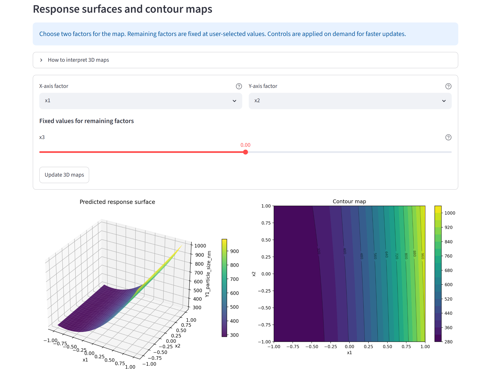
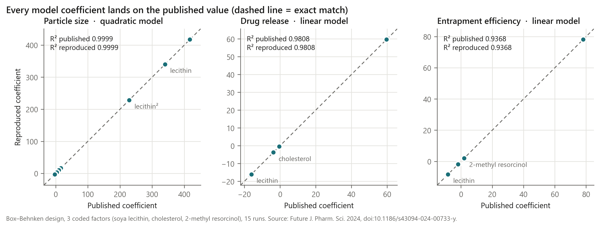

# DoE Analyzer

[](https://github.com/sMelegar8/doe-scientific-analyzer/actions/workflows/tests.yml)

A Python app that takes the results of a designed experiment from a spreadsheet and guides a scientist from model selection to the next experiment: diagnostics, effect screening, response surfaces, multi-response trade-offs and PCA, with a short explanation next to every statistic.



## The question

Formulation and process scientists run designed experiments (DoE), but to understand which factors matter and where to place the next run they normally need spreadsheets, statistical software and the help of a statistician. Can one local app make this analysis accessible, and can its results be trusted?

## Data

The repository contains only public or synthetic data:

| File | Content | Source |
|---|---|---|
| `examples/curcumin_plarosomes_benchmark_dataset.csv`, `benchmarks/benchmark_public_curcumin_plarosomes.xlsx` | Box–Behnken design, 3 factors, 15 runs, 3 responses (particle size, drug release, entrapment efficiency) | Development, characterization, and assessment of PLAROsomal vesicular system of curcumin, *Future Journal of Pharmaceutical Sciences* (2024), [doi:10.1186/s43094-024-00733-y](https://doi.org/10.1186/s43094-024-00733-y) |
| `benchmarks/benchmark_public_chemreact.xlsx`, ChemReact and heli data inside `doe_pro.py` | Classic response-surface examples | R package `rsm`; Lenth, *J. Stat. Softw.* 32(7), 2009, [doi:10.18637/jss.v032.i07](https://doi.org/10.18637/jss.v032.i07) |
| `examples/sample_dataset.csv` | Small reaction-optimization example | Synthetic |

## Method

- Factors are columns whose name starts with `x`, optional blocks start with `block`, and the other numeric columns are responses. Run, order and ID columns are ignored.
- Factors are coded to −1/+1 automatically, or manually when a published coding has to be reproduced.
- Linear, interaction, quadratic and full models are fitted with ordinary least squares (statsmodels). Censored responses (values such as `<5`) use a Tobit model.
- Residuals, observed-versus-predicted plots, Q–Q plots and influence are shown before any optimal setting, so a poor fit is visible before someone relies on it.
- Response surfaces, contour maps, multi-response desirability and PCA help to choose the next confirmation experiment. The suggested optimum is a candidate, not an answer.

## Results and tests

The app reproduces published models. `pytest` checks this on every push:

| Benchmark | Model | R² published | R² reproduced |
|---|---|---|---|
| Curcumin PLAROsomes, particle size | quadratic | 0.9999 | 0.9999 |
| Curcumin PLAROsomes, drug release | linear | 0.9808 | 0.9808 |
| Curcumin PLAROsomes, entrapment efficiency | linear | 0.9368 | 0.9368 |

Every curcumin coefficient agrees with the published equation within 0.01, the rounding used in the article. The tests also refit the second-order ChemReact and heli models of the `rsm` article (R² 0.998 and 0.955) and check the stationary point and the steepest-ascent path.



The benchmark also showed a limit: the authors kept a quadratic model for particle size but linear models for the other two responses, while the app fits one model structure per session. Per-response model selection is the next improvement.

## How to run it

Python 3.10 or newer.

```bash
pip install -r requirements.txt
streamlit run doe_pro.py
```

Then upload `benchmarks/benchmark_public_curcumin_plarosomes.xlsx`, or open **Public benchmarks** in the sidebar. A command-line version of the core analysis is also available:

```bash
python main.py --data examples/sample_dataset.csv --factors temperature_c catalyst_pct time_min --response yield_pct --model quadratic --outputs outputs
```

Run the tests with `pip install pytest` and `pytest -q`.

## Repository layout

- `doe_pro.py`: the Streamlit app (analysis, planner, benchmarks, export).
- `src/`, `main.py`: a smaller modular toolkit and command-line workflow. It does not yet cover everything the app does (Tobit models, blocks, planner).
- `benchmarks/`: public benchmark workbooks and their validation notes.
- `docs/generate_curcumin_doe_outputs.py`: regenerates the figures in `outputs/curcumin_plarosomes/`.
- `tests/`: benchmark reproduction tests.

## Limits

- This is a research prototype, not validated software for regulated (GxP) use.
- The app and the modular toolkit are two implementations with different scope.
- Statistical results depend on the chosen model; the diagnostics are there to be read, not skipped.

## Origin and credits

The tool started during my research at the University of Parma, and I used it for the DoE studies of my postdoctoral work. I defined the scientific workflow, the views and the benchmark criteria, and I developed the code with AI-assisted programming. The statistical methods come from statsmodels, SciPy and pandas. The project is not affiliated with or endorsed by any university or employer.

Matteo Melegari · [LinkedIn](https://www.linkedin.com/in/melegarimatteo) · [ORCID 0000-0002-7252-7587](https://orcid.org/0000-0002-7252-7587)
